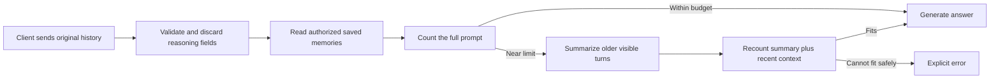

# Conversation compaction and client compatibility

**Implemented 2026-09-10.** All six vLLM profiles enable bounded, request-local
compaction. The default policy model remains disabled unless a profile enables it.
Compaction summarizes older visible turns; it does not save memories to ParadeDB,
edit the client transcript, or provide unlimited conversation storage.

## Why the two reported errors occurred

`messages.2.reasoning_content (extra_forbidden)` was strict message validation
rejecting a reasoning field BoltAI resubmitted with an earlier answer. Incoming
`reasoning_content` and `reasoning` now accept a string or null and are discarded.
Only role and visible content enter normal generation, token counting, memory query
selection, or summarization. Unknown fields, images and invalid reasoning types
remain rejected. The raw HTTP body limit still counts these fields before removal.
Reasoning pasted into the ordinary `content` string is visible text; this change does
not attempt to identify or remove arbitrary text from that field.

`Context budget exceeded` meant the prompt, reserved output and margin exceeded the
profile's policy window. Backend capacity and profile allowance are distinct: vLLM
advertised 95,000 tokens during the 2026-09-10 check, but assistant/creative still use
16,384 and research uses 32,768. Compaction does not increase those settings.

| Profile | Window | Reserved output | Margin | Usable input | Compaction trigger (85%) |
|---|---:|---:|---:|---:|---:|
| local-assistant | 16,384 | 2,048 | 256 | 14,080 | Above 11,968 |
| local-creative | 16,384 | 8,192 | 256 | 7,936 | Above 6,745 |
| local-research | 32,768 | 8,192 | 256 | 24,320 | Above 20,672 |

These are the deployed output reservations; profiles permitting client output limits
compute the trigger from the effective request reservation. Input includes system
policy, selected memories, visible history and, for research, authorized tool schemas.

## Pipeline



1. Check identity/profile authorization and retrieve memory as before. Nothing in
   compaction grants a new profile, memory permission or tool.
2. Count the complete prompt with vLLM's tokenizer and the generation template.
   Short requests need no summarizer call. Requests near the limit that have no
   older turns can continue unchanged if they still fit.
3. Aim to retain the configured recent user turns (four in bundled profiles) and their replies. If that leaves
   insufficient room, preserve only the current user turn and summarize more of
   the preceding history. The current user question is never shortened or summarized. See the 2026-09-11
   tool-evidence exception below for oversized returned results.
4. Summarize the older prefix using the same local model with thinking disabled and
   no tools. The summarizer receives visible history as untrusted JSON, not as system
   instructions. It is directed to preserve goals, decisions, corrections, unresolved
   questions, exact identifiers and the distinction between home/work environments.
5. Pack source messages into bounded chunks. A single oversized *older* message can
   be split at character boundaries; every remaining segment must also be processed.
   Each call carries forward a rolling summary of earlier chunks. Exact selected
   summary inputs are token-counted before generation, using the summary template.
6. Require a complete, nonempty summary with bounded output and no tool calls.
   Truncation, timeout or exhausted work budget stops the request; no partial summary
   silently replaces history. A valid but unhelpful summary can be discarded when
   the original prompt still fits (`not_beneficial`).
7. Insert the summary as labeled untrusted JSON before the first retained user
   message. Keep system policy intact and recount the complete final prompt.
   Current instructions take precedence over old preferences. The model is directed
   to distinguish old assertions and uncertainty from verified facts.
8. Generate normally. Append a visible **Context compacted** notice to the answer.
   In normal streaming, the notice follows final text and precedes the stop marker.
   Research includes it in its buffered answer. The client's original transcript
   remains the source of detail the summary may omit.

Research compacts prior client history **once before** its tool loop. It does not
summarize current tool results or evidence midway through research; later rounds
still enforce their own context/output limits. Internally generated research planning
fields keep their existing handling and do not enter this pre-loop compaction pass.

## Configuration

```yaml
compaction:
  enabled: true
  trigger_ratio: 0.85
  target_recent_turns: 4
  max_summary_tokens: 4096
  max_summary_bytes: 32768
  max_calls: 4
  timeout_seconds: 90.0
```

`max_summary_bytes` defaults to 8,192 in code; bundled profiles explicitly allow
32,768 bytes. `max_summary_tokens` caps each rolling summary, not the final answer.
Four calls at the bundled 4,096-token limit permit at most 16,384 generated summary
tokens in addition to the normal answer budget. Model-specific backend options and
profile sampling are retained; thinking/preserved thinking are turned off for summary
calls, presence penalty is zero, and tool choice is none. Tools and profile stop
strings are not supplied to the summarizer. Normal answer thinking and sampling are
unchanged.

Compaction requires `token_count_mode: vllm` and `overflow: reject`; incompatible
settings fail startup. Summary calls share the harness concurrency slot and existing
request deadline. A separate 90-second compaction limit applies to the original
profiles; `local-tools` now allows 180 seconds (see the 2026-09-11 update below). The summary
stage happens before normal streaming headers/answer tokens, so a client must allow
sufficient initial response time. It adds local model work only when triggered.
Research emits its existing SSE heartbeats while its preparation/tool loop runs.

To disable compaction on a profile, set `enabled: false` and restart the service.
The prior reject-on-overflow behavior resumes. Increasing context size is a separate
operator decision that must remain within verified backend capacity.

## Persistence and limits

The harness remains stateless with respect to conversation summaries: it computes
compaction from the transcript supplied **on that request**, then releases its local
state. It does not write summaries to disk or the memory database, nor reuse another
request's summary. Thus a long transcript resent on the next turn may be summarized
again. This can add latency and produce slightly different summaries. A future
identity-scoped conversation-state service could avoid that repeated work, but is
not implemented here.

Compaction is lossy. It can omit details, misattribute statements or lose exact code.
The home/work instruction helps preserve labels; it is **not** the planned database
environment boundary and cannot guarantee the two labs will never be mixed. Keep
important exact source material available and evaluate the summaries' effects.

There are still explicit limits: 1,048,576 request bytes, 512 submitted messages, the
profile window, the compaction call/time/output limits, and the unchanged latest
request. A giant current message or insufficient room for required context can still
return 400. Compaction does not silently truncate the current task to force it through.

## Diagnostics and rollback

Normal chat responses include `X-Harness-Context-Status`,
`X-Harness-Compaction-Calls` and `X-Harness-Summarized-Messages`. Status is `disabled`,
`not_needed`, `not_beneficial`, or `compacted` on successful requests. JSON responses
that use compaction additionally contain `harness_context`; research JSON responses
include its preparation state. Streaming research uses the visible notice rather
than late HTTP headers for the compaction outcome. Clients may ignore custom headers.

Structured `context_compaction` logs include request/actor IDs, status, prompt counts,
summary-call/output counts and elapsed time, not transcript, reasoning or summary
text. Final generation usage retains its existing meaning; the separate summary
work is reported in compaction diagnostics rather than added to its usage object.
Compaction policy participates in the profile fingerprint; the versioned summarizer
prompt lives in `compaction.py`.

Disabling compaction stops summary calls while retaining the BoltAI compatibility
fix. For a full code rollback, restore a reviewed source version and rebuild;
no database rollback is needed. Keep deployment secrets outside source archives.

## Verification

129 tests passed with a disposable PostgreSQL database and mocked generation. Coverage
includes reasoning-field removal, exact summary input counts, splitting older messages
without dropping source segments, protecting the latest request, truncated/empty/oversize
summary rejection, work/deadline limits, released concurrency slots, research tool
permissions and streaming notice ordering. Existing identity, memory, recall and
research tests remain included.

The live check replays a BoltAI-style follow-up and a large synthetic conversation
with different home/work GPUs assigned to the same server name. This is a targeted
compatibility/continuity check, not a claim that all real conversations compact
without losing detail. No persistent user memory is created by these checks.


Live results on 2026-09-10 (a repetitive synthetic transcript, 133,723 JSON bytes):

| Profile | Original input tokens | Compacted input tokens | Summary calls | Summary-stage time | Complete response time |
|---|---:|---:|---:|---:|---:|
| local-assistant | 24,297 | 12,468 | 1 | 2.8 s | 9.3 s |
| local-creative | 24,263 | 593 | 2 | 12.2 s | 15.3 s |
| local-research | 25,226 | 13,377 | 1 | 2.5 s | 11.9 s |

All three retained the requested synthetic HOME/WORK GPU mapping and emitted the
compaction notice. Creative retained less verbatim history because its 8,192-token
answer reservation leaves less input room. These timings include a warm backend and
highly repetitive source text; they are not a load benchmark or expected compression
ratio for real technical conversations. A BoltAI-shaped reasoning-content follow-up
also passed. Explicit memory save/search/fresh-chat recall/delete passed separately;
the synthetic record was removed and the live memory table ended empty.

## UI tools and model swaps — 2026-09-10 update

`local-tools` also enables compaction. Current user/tool exchanges stay intact; only
older exchanges become quoted summary data. All attached schemas count toward the
budget. Saved recall uses the latest user text rather than a tool-result body.
Auto-selected models use their resolved profile window and recipe consistently for
tokenization, summarization and final generation. Existing Qwen windows in the table
remain unchanged. Other models are capped to advertised capacity, up to the configured
131,072 ceiling. See [TOOLS_AND_MODELS.md](TOOLS_AND_MODELS.md).

Standard usage still describes final generation (or internal research rounds).
`harness_usage` now exposes summary counts and a combined total separately in JSON and
final SSE usage events. See [TELEMETRY.md](TELEMETRY.md).

## Oversized current tool evidence — 2026-09-11

The earlier promise to retain every current tool-result body verbatim was too strict
for large fetched pages. `local-tools` now opts into `summarize_tool_results: true`:
only oversized tool evidence can be replaced with an explicitly labeled lossy summary.
Current user text and call IDs/arguments stay verbatim. Tool and history summaries
share an eight-call/180-second work budget on `local-tools`, with evidence inputs
capped at 32,768 tokens per chunk, and all source chunks must be processed.
Small tool results remain unchanged. The tool profile also now uses available backend
capacity up to its 131,072 ceiling, including for Qwen. Other Qwen windows are unchanged.
See [BOLTAI_TROUBLESHOOTING.md](BOLTAI_TROUBLESHOOTING.md) for diagnosis and limitations.

## 2026-09-25: Longer continuity summaries

Bundled profiles now allocate up to 4,096 tokens / 32,768 UTF-8 bytes per summary
and aim to retain four recent user turns and their replies. Code validation allows
up to 8,192 tokens / 65,536 bytes for operator tuning, still constrained by exact
token counting and the actual backend context window. No source text is silently
truncated to fit the summary. Larger summaries may increase latency.

`local-tools` already used the live backend's full advertised 75,000-token window
when checked. Its 131,072 profile ceiling remains capped by backend discovery;
raising that ceiling alone would not provide more context. The old 1,024-token
summary and two-turn retention were narrower continuity budgets within that window.

Summaries now explicitly distinguish completed work from open requests; continuation
instructions tell the model to answer the latest user request rather than replay
an earlier answer. Regression coverage checks that four recent turns (when they
fit) and the current request remain intact. These changes do not establish the
cause of the operator's reported repeated answer: the available live logs did not contain
the relevant compaction event, and the full conversation was not supplied.

Live sampling overrides were preserved during deployment. Repository local-tools
sampling and its additional answer-quality rule differ from deployed settings;
this update does not reconcile those pre-existing differences.

Live synthetic continuation check (2026-09-25): a temporary 12,000-token test
profile using the real qwen3.8-27b backend compacted 25,484 input tokens through
four summary calls to a 391-token final prompt. Seven messages across four recent
user turns remained, and the model returned the newly requested NEXT-STEP-READY
marker instead of the earlier completed answer. Memory was disabled for this test;
production profile limits were unchanged. This is a focused regression check,
not a reproduction of the user's original long conversation.
