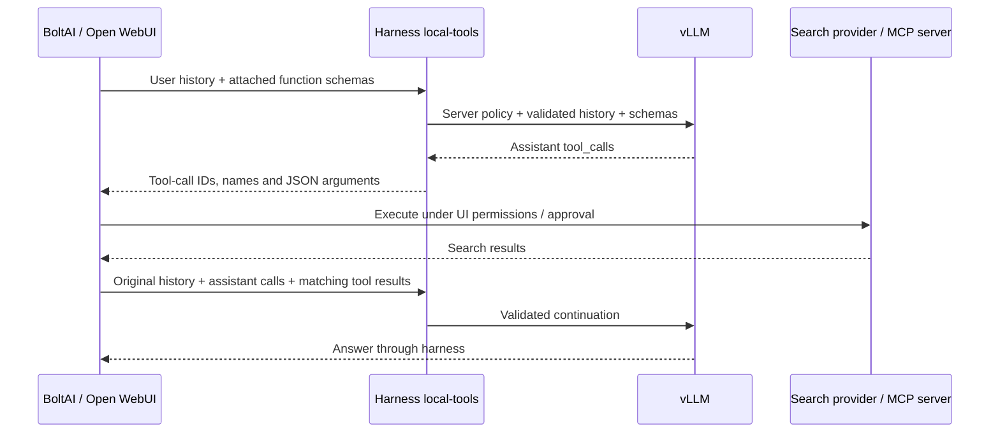

# UI tools and automatic backend selection

Implemented 2026-09-10. Stable public profile IDs now follow the single model loaded
in vLLM. A fourth profile, `local-tools`, transports OpenAI function calls for a client
such as BoltAI or Open WebUI. It does not execute tools inside the harness host.

## Start with BoltAI

1. Keep the existing custom OpenAI-compatible provider pointing to
   `http://<harness host>:8200/v1` with the harness key.
2. Refresh its models and select **local-tools**. If your BoltAI version requires
   manual model entry, use exactly `local-tools` and enable its tool/function capability.
3. Attach the search tool you already configured in BoltAI to that conversation.
   If none is configured, configure a supported search service or MCP search server
   in BoltAI first. Provider-native hosted tools such as `web_search_preview` are
   not OpenAI function definitions and cannot be passed to a local vLLM model.
4. Ask for a current, public fact with source links. Check BoltAI's tool activity and
   the returned URLs. Then ask a follow-up that needs the previous search result.

BoltAI v2 documents Settings → Plugins for search providers and the composer Tools
button for per-chat selection. Your version may label these differently. Search
credentials remain in BoltAI; the harness does not need a search-provider account.
Sources: [BoltAI search tools](https://help.boltai.com/articles/0378405-use-web-search-and-local-file-tools-in-boltai-v2),
[Open WebUI native tools](https://docs.openwebui.com/features/extensibility/plugin/tools/).

For Open WebUI, select `local-tools` and attach the desired native tools. Keep client
tools off on assistant, creative, and demo research. That research profile retains
its separate harness-owned synthetic-note loop and existing grants.

## What executes where

The profile accepts any properly shaped client function definition, not just names
that look like search. This is intentionally a **trusted-client transport**, not an
enterprise tool authorization service. Tool names/descriptions are supplied by the
client and cannot prove that a tool is read-only or safe. Limit attached tools and
approve writes in the UI/executor. The harness never runs shell commands, performs
web fetches for these tools, or obtains their credentials. The model's tool choice
is a request for execution, not proof that execution happened.

In JWT mode, access requires both the profile grant and `client_tools: true` in the
verified role grants. Existing roles omit that flag and therefore have no access.
The personal lab service key has access. Tool identities, argument validation against
the real executor's schema, destination restrictions, write approval and per-resource
access remain executor responsibilities. For enterprise use across changing UIs,
use harness-owned registered tools with independently authenticated execution instead.
Client-returned results are untrusted evidence, not authenticated execution receipts.

The bridge validates typed schemas, JSON-object arguments in returned history, unique
call IDs, matching results, and complete exchanges. No pending call may be bypassed
by a new user turn. At most 128 definitions and 16 calls per assistant message are
accepted. `auto`, `none`, `required`, and a named attached function are supported.
Parallel calls default off but may be explicitly requested. System/developer messages
are still discarded; historical reasoning fields are still stripped. Content is text
only; multimodal and provider-specific hosted tool formats remain unsupported.

The bundled HTTP request cap is now 1 MiB (previously 256 KiB), so longer model
windows are not prematurely limited by a roughly 64k-token English transcript.
The 512-message cap and exact token budgets still apply. Larger requests consume more
CPU/memory while validating and counting; adjust the ceiling deliberately.

The UI runs the loop across separate API calls. Per-request context/output/deadline
limits apply, but there is no cross-request tool-call quota or durable tool ledger.
Configure a loop/iteration limit in the client. Cancellation cannot undo an action
already performed by the client. No automatic retry is added by the harness.

## Compaction and saved memories

Compaction splits at user-turn boundaries, keeping the current question and its
assistant-call/tool-result links intact. Oversized current tool results can now be
summarized as explicitly lossy evidence; current user text and call IDs/arguments stay
verbatim. Older complete exchanges can be summarized
as quoted JSON data; they are never replayed as executable calls. Tool schemas are
included in exact token counts. Oversized questions/schemas and work-limit failures
can still be rejected. See [BOLTAI_TROUBLESHOOTING.md](BOLTAI_TROUBLESHOOTING.md). The summary model never receives executable tools.
Memory recall uses the most recent **user** text even when the request ends with a
tool result; recalled context is attached to that user turn, never forged into a tool
result. This does not enable automatic memory saving. UI memory tools store wherever
the UI configures them, not automatically in ParadeDB.

## Switching vLLM models

All bundled profiles set `backend_model: auto`. Every request queries `/v1/models`,
requires exactly one advertised ID, reads its `max_model_len`, and resolves one
request-local profile used for tokenization, summaries and generation. No restart of
the harness is needed just because the served model changes. UI model IDs stay stable.

Unknown models use the backend's generation defaults: the bundled base profile has
null temperature/top-p/presence penalty and empty backend options, so those fields
are omitted. With `--generation-config auto`, vLLM can use the model's supplied recipe;
this is not a guarantee that every model ships good defaults. It is not possible to
infer an arbitrary model card's ideal thinking mode automatically. Add an exact-ID
preset when a model needs deliberate overrides.

`backend_presets.qwen3.8-27b` preserves the tested Qwen values, including assistant/tools
thinking off and creative/research medium. No Qwen template kwargs are sent to an
unknown MoE model. Keep served model names distinctive; reusing `qwen3.8-27b` for a
different model would deliberately select the Qwen recipe.

| Profile | Qwen context / output | Other model context ceiling / output |
|---|---:|---:|
| local-assistant | 16,384 / 2,048 | 131,072 / 2,048 |
| local-creative | 16,384 / 8,192 | 131,072 / 8,192 |
| local-research | 32,768 / 8,192 | 131,072 / 8,192 |
| local-tools | 131,072 ceiling / 4,096 | 131,072 / 4,096 |

Effective context is the smaller of the selected profile/preset window and vLLM's
advertised capacity. Output and margin still reserve space, and compaction starts
at 85% of usable input. The lab backend advertised **75,000** on this deployment check;
this is a dated observation, not a configured promise. Switching to an MoE does not
by itself guarantee a longer context window or faster generation.

If multiple models/aliases are advertised, auto returns a clear 503 instead of choosing
an arbitrary first model. Pin `backend_model` to the desired ID in that case. Exact-ID
presets also apply to pinned profiles, but their context capacity is operator-verified;
only auto discovery caps it dynamically. Missing capacity metadata or an output budget
that cannot fit also fails closed. A backend swap during an in-flight request can fail;
the harness does not silently retry against another model.

vLLM still owns the correct chat template, reasoning parser, tool-call parser, GPU/KV
allocation and maximum model length. Change those launch settings for the new model.
Models must support text chat and vLLM's chat `/tokenize`; tool profiles additionally
need functioning tool parsing. A reasoning-only model that cannot complete a bounded
summary may reject compaction until an appropriate model preset is configured.

Response headers identify the resolved model and context:
`X-Harness-Backend-Model`, `X-Harness-Context-Window`. The profile fingerprint covers
all configured recipes; logs identify the actual backend and effective sampling.

## Rollback

Set `client_tools: false` or remove `local-tools` to disable the bridge. Pin backend IDs
and verified windows to disable automatic model following. Restart after config edits.
Restore `/root/harness-before-ui-tools-20260910.tar` on the harness host for a full runtime rollback; no database schema,
password, vLLM launch flag, or frontend configuration changed in this release.

## Validation record

164 automated tests passed, including a real disposable UTF-8 PostgreSQL database.
Tests cover model swaps and ambiguous/undersized catalogs, exact-ID recipe selection,
tool history validation, streaming calls, disabled profiles, JWT grants, memory recall
on tool follow-ups, compaction with current/older tool exchanges, usage preservation,
and protected metrics access. Model swaps were simulated; the lab GPU was not switched.

Live checks on the harness host passed for all four profiles, default streaming usage, an actual
model-generated `search_web` call followed by a synthetic result and final answer,
reasoning metadata handling, rejection on non-tool profiles, and authenticated metrics.
No search provider was called during the fixture test. Actual BoltAI tool selection
and provider execution remain a UI acceptance check for the owner.

A live long-history `local-tools` follow-up compacted an older filler-heavy turn in
one call, retained the current tool-result marker, and correctly distinguished
fictional home RTX 5090 from work RTX A4000. Its 16.06-second elapsed time is a synthetic
example, not a performance guarantee. No persistent memory was saved by these live tests.

### Open WebUI: tools (too_long)

The previous request schema capped tool definitions at 32. A client advertising
more functions failed before inference even on a tool-enabled profile. The generic
“text chat only” suffix was misleading. The cap is now 128; requests over that
limit report the cap and suggest disabling unused tools/toolkits. Other validation
errors identify the invalid field without claiming that tools are disabled.
Tool catalogs are forwarded intact and included in token counting. Request-byte
and context limits still apply, and non-tool profiles still reject client tools.
This addresses the reported schema error; the actual Open WebUI catalog was not
captured or changed.

## Thinking defaults, 2026-10-09

All bundled Qwen chat profiles, including optional deployment-only packs, now enable
medium thinking in their exact-ID `qwen3.8-27b` preset. Previously assistant/tools/
home/work and the optional pack's profiles disabled it; creative/research already used medium.
Unknown model IDs still inherit backend defaults rather than receiving Qwen-specific
template arguments. Compaction summary requests deliberately disable thinking;
`preserve_thinking: false` still prevents historical reasoning from being carried
forward and does not disable reasoning for the current answer.

Output budgets are unchanged and cover reasoning plus the final response. Inspect
finish_reason and usage if a complex request consumes the budget before answering.
Benchmark chat generation separately from compaction calls.
